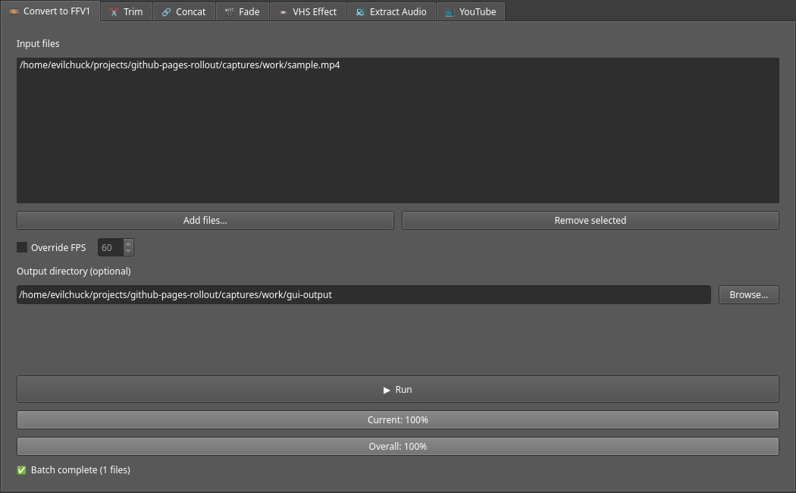
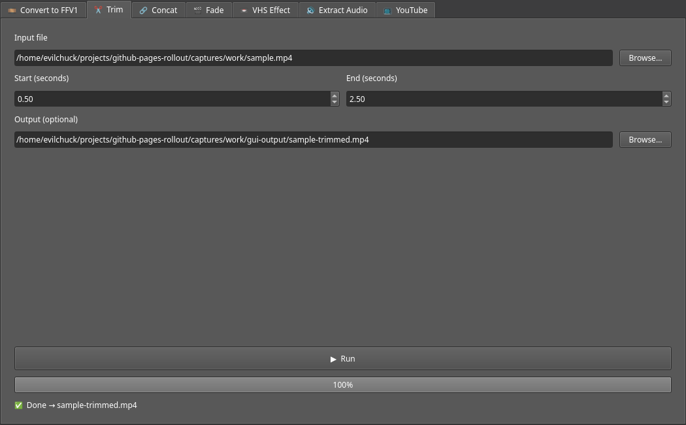
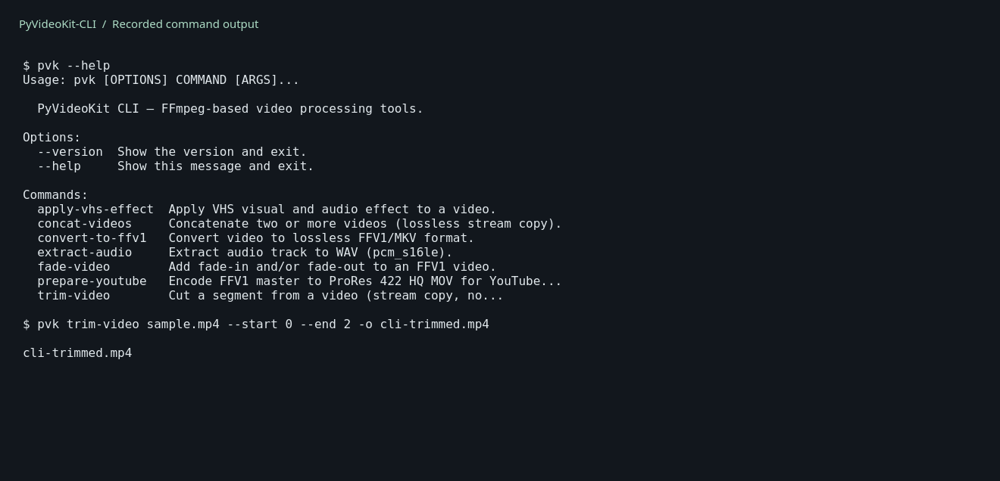
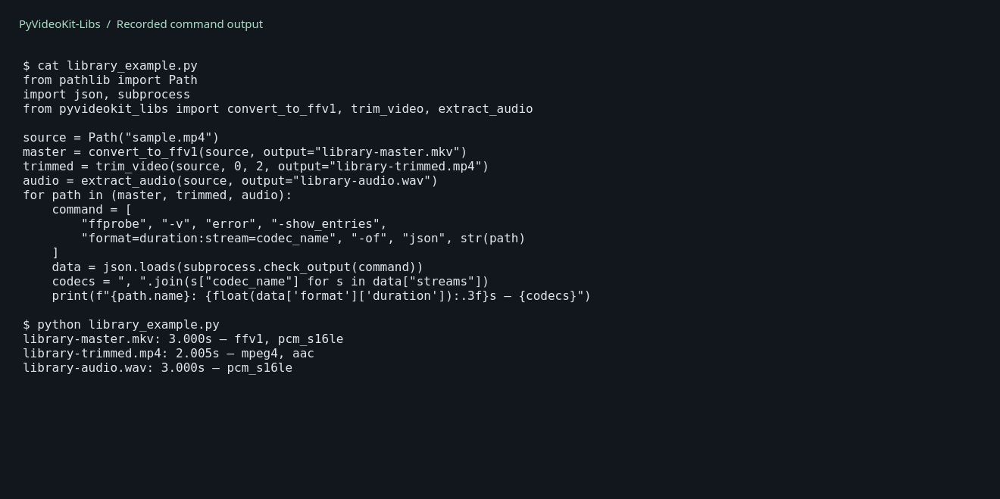

# 🎬 PyVideoKit


[](LICENSE)
[](https://github.com/Evilchuck666/PyVideoKit/releases/latest)
[](https://github.com/Evilchuck666/PyVideoKit/actions/workflows/release.yaml)

**FFmpeg-based video processing for Python: a library, a CLI and a desktop GUI.**

PyVideoKit trims, fades, converts and gives a VHS look to your videos. Use it
from Python code, from the command line or from a drag-and-drop desktop app,
on Windows, GNU/Linux or macOS.

🌐 **Website:** https://evilchuck666.github.io/PyVideoKit/

<!-- SCREENSHOTS:START -->
## 📸 Screenshots



The desktop app after an FFV1 conversion.

<details>
<summary>More screenshots</summary>



The desktop app after a trim.



The command line: `pvk` help and a two-second trim.



Using PyVideoKit-Libs from Python.

</details>

<!-- SCREENSHOTS:END -->

## ✨ Features

- 📚 **[PyVideoKit-Libs](https://github.com/Evilchuck666/PyVideoKit/tree/main/packages/libs)** — Core Python library. All video processing functions are built on top of FFmpeg, FFprobe, and SoX. Base dependency for the other packages.
- 💻 **[PyVideoKit-CLI](https://github.com/Evilchuck666/PyVideoKit/tree/main/packages/cli)** — Command-line interface built on PyVideoKit-Libs. Each operation is exposed as a standalone command (`pvk`, `trim-video`, `fade-video`, etc.).
- 🖥️ **[PyVideoKit-GUI](https://github.com/Evilchuck666/PyVideoKit/tree/main/packages/gui)** — PySide6 desktop GUI. Tabbed interface with drag-and-drop input, batch processing for Convert/VHS/Extract Audio/YouTube.
- 🏗️ **[arch/](arch)** — PKGBUILD for Arch Linux. Builds `python-pyvideokit-libs`, `python-pyvideokit-cli`, `python-pyvideokit-gui` and the `python-pyvideokit` meta-package. Mirrors the [AUR package base](https://aur.archlinux.org/pkgbase/pyvideokit).

## 📥 Download

| Channel | Package |
| --- | --- |
| Arch Linux (AUR) | [python-pyvideokit](https://aur.archlinux.org/pkgbase/pyvideokit) |
| PyPI | [PyVideoKit](https://pypi.org/project/PyVideoKit/) |
| GitHub release | [Wheels and source archives](https://github.com/Evilchuck666/PyVideoKit/releases/latest) |

[Release notes](https://github.com/Evilchuck666/PyVideoKit/releases/latest) · [SHA256SUMS.txt](https://github.com/Evilchuck666/PyVideoKit/releases/latest/download/SHA256SUMS.txt)

## 🚀 Getting started

### 🏗️ Arch Linux (AUR)

Install all three packages at once with the meta-package:

```bash
yay -S python-pyvideokit
```

Pacman pulls in system dependencies (FFmpeg, FFprobe, SoX) automatically.

### 🐍 Other systems (pip)

```bash
pip install PyVideoKit
```

This installs PyVideoKit-Libs, PyVideoKit-CLI, and PyVideoKit-GUI in one go.
Make sure **FFmpeg**, **FFprobe**, and **SoX** are available in your `PATH`.

### ▶️ First run

```bash
pvk-gui        # open the desktop app
pvk --help     # list the command-line tools
```

## 📋 Requirements

- Python 3.10 or newer.
- **FFmpeg**, **FFprobe** and **SoX** in your `PATH`.

## 📚 Learn more

Build the packages from a checkout with `make`:

```bash
make help          # show all available targets
make build-all     # build all wheels (Libs + CLI + GUI + meta-package)
make install-all   # build and install all packages locally
make aur           # build and install AUR packages with makepkg
```

- [Technical guide](TECHNICAL_GUIDE.md): desktop integration for non-Arch
  systems and the build targets.

## ⚖️ License

PyVideoKit is free software released under the **GNU General Public License v3.0** (GPL-3.0). See [LICENSE](LICENSE).
